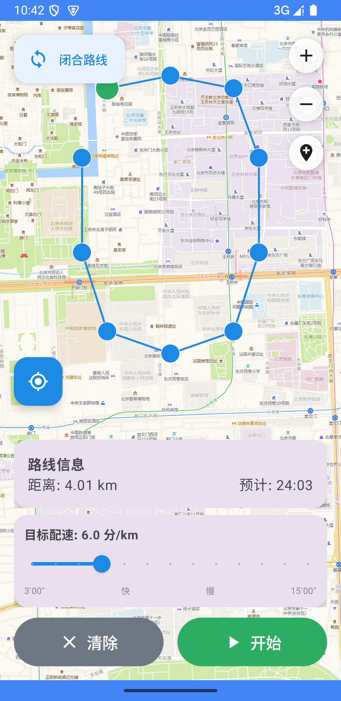

# 虚拟跑步 (VirtualRun)

一款免 Root 的 Android 虚拟跑步定位 App，支持在地图上规划路线并生成更接近真人跑步的连续轨迹。无需任何 API Key，国内网络直连即可使用。

当前版本：**v1.3.0**（源码）· 最低支持 Android 8.0（API 26）

## 功能特性

- **免 Root**：使用 Android 标准 Mock Location API，无需 Root 权限
- **国内直连地图**：内置高德地图瓦片源，无需 VPN，无需 API Key，开箱即用
- **卫星地图切换**：右上角切换普通／卫星底图，保留路线与视角，并记住上次选择；首次加载需要网络
- **高倍地图缩放**：原生瓦片保持在稳定的 `z18`，通过本地超采样继续放大到 `z22`，避免高倍缩放后地图空白
- **地图中心选点**：屏幕中心固定光标 + 拖动地图对准，点「确认落点」加入路线，可随时取消或重新进入选点
- **快速定位当前地址**：一键取系统定位、换算 GCJ-02、飞到当前位置并反查地址显示
- **绕圈循环跑**：再次点击起点标记即可闭合路线，支持无限循环跑步
- **自然绕圈轨迹**：闭环路线使用定长圆角，并加入每圈轻微内外偏移，避免生硬折线和机械重合
- **定位偏移修正**：在中国地图上点击定位时，自动将系统 WGS-84 坐标转换为 GCJ-02 显示，避免地图偏移
- **配速调节**：可调节跑步配速（3-15 分钟/公里）
- **快速调速**：起跑后快速跟上目标配速；跑步过程中修改目标配速会在下一次采样附近完成响应
- **稳定速度范围**：稳定跑动时，报告速度和相邻轨迹推导速度均限制在目标速度的 ±15% 范围内
- **自然速度扰动**：使用连续、相关的低频与高频波动，避免逐秒随机跳变
- **立即停止**：点击停止后立即结束模拟定位，不再经历“平稳停止”或缓慢减速过程
- **异常配速保护**：低速和停止状态不再显示数百分钟每公里的失真配速
- **轨迹平滑**：闭环和开放路线均采用定长圆角与等距离重采样，路线连续自然
- **后台保活**：前台服务 + 唤醒锁，APP 后台或锁屏时虚拟定位持续生效
- **多通道定位**：同时投递 Android 系统定位和 Google Play 融合定位；融合通道异常时不阻塞系统定位，并自动重试。第三方应用是否接受模拟位置取决于其定位与记录策略
- **实时进度**：显示路线距离、预计用时、跑步进度和当前配速
- **自洽 IMU 合成（实验）**：由轨迹反推步频/步幅/姿态，生成 10Hz 加速度、陀螺与旋转矢量，
  步频↔速度、位移↔步数、重力↔`q*`、航向↔轨迹方位互相可推导；详见
  [IMU 合成与一致性](docs/imu-synthesis.md)

## 截图


*最新版八点闭环路线规划界面*

## 下载安装

**[>>> 点击下载 VirtualRun v1.0.5 APK <<<](https://github.com/uinaqx/VirtualGPS-Run---MAX/releases/download/v1.0.5/VirtualRun-v1.0.5.apk)**

也可以前往 [GitHub Releases](https://github.com/uinaqx/VirtualGPS-Run---MAX/releases/latest) 查看最新版本和更新说明。

> 上述安装包对应已发布的 v1.0.5；当前源码为 **v1.3.0**（versionCode 9），还没有发布对应 APK，
> 可按下文「构建项目」在本地或 GitHub Actions 自行构建。

- APK 版本：`1.0.5`（versionCode 6）
- SHA-256：`BFFDE6E9FEB580CC6588C763692FC5DF990AD2877E9153F3C22D5420E9100DE3`

> 当前 APK 使用 Android Debug 签名，可直接安装测试；项目尚未配置用于应用商店发布的正式签名密钥。

## 使用方法

> **说明**
>
> 本应用通过 Android 模拟位置（mock location）输出虚拟坐标，用于定位功能自测、地图渲染调试、
> 轨迹回放与演示。请在遵守目标平台条款的前提下使用，产生的后果由使用者自行承担。

### 1. 安装与设置

1. 下载上方 APK 并安装到 Android 手机
2. 打开应用，授予**位置权限**和**通知权限**
3. 进入 **设置 → 系统 → 开发者选项 → 选择模拟位置信息应用**，选择「虚拟跑步」

> **提示**：如果找不到开发者选项，进入「关于手机」连续点击「版本号」7 次即可开启。

### 2. 规划路线

1. 地图中央有一个固定的十字光标；**拖动地图**把它对准目标位置
2. 点底部**选点面板**上的图钉进入选点。面板会实时显示光标对应的**预选经纬度**（GCJ-02）以及这是第几个点
3. 点击**「确认落点」**把该位置加入路线（起点为绿、途经为蓝、终点为红）
4. 想放弃当前预选点就点**「取消」**（光标隐藏，避免误落点）；再次点图钉可重新进入选点模式
5. 在选点面板里点击**「闭环」**（≥3 个点）。**不会**因为新点靠近起点而自动闭环
6. 选点面板和配速面板右上角都有**「最小化」**：收起后只留一行，再点**「展开」**即可恢复。拖动地图时配速面板会自动最小化，避免挡住中心光标

> **自动保存**：每次落点 / 删除 / 闭环 / 改名 / 清空都会立即写入本地，重启应用自动恢复上次路线；
> 误点「清除」后还可以用「恢复上次路线」撤回。点击路线上的点可以删除该点。
>
> **轨迹提示**：闭环路线开始跑步后，实际虚拟轨迹会自动圆角化，并在每圈加入轻微自然漂移，不会完全机械地贴着手动画出的折线跑。

### 3. 开始虚拟跑步

1. 点底部**配速面板**的「展开」，拖动滑块设置目标配速（3-15 分/公里）。不需要时点**「最小化」**，只留一行配速
2. 点击「开始」按钮启动虚拟定位
3. 跑步过程中可随时展开配速面板，拖动滑块**快速调整配速**，也可以**暂停 / 继续**
4. 点击「停止」后会立即结束虚拟定位并清除模拟定位服务

> **注意**：开始跑步后，即使返回桌面或锁屏，虚拟定位仍会继续运行。

### 4. 快速定位到当前位置

选点面板标题行上的**定位按钮**（准星图标）一次点击即可：

1. 取一次最新的系统定位（先看缓存，缓存不够新就向 GPS / 网络各要一次单点定位，最长等 6 秒）
2. 按中国地图坐标系规则把 WGS-84 换算成 GCJ-02 后把地图飞过去（缩放级别 17.5）
3. 反查地址并在选点面板摘要里显示「当前地址」，同时把中心光标同步到该位置——选点模式下可直接「确认落点」

> 同样的入口也放在右上角地图工具菜单里；系统定位关闭或权限未授予时会提示并给出跳转设置。

### 5. 界面说明

| 位置 | 元素 | 说明 |
| --- | --- | --- |
| 右上 | 地图工具菜单 | 卫星／普通底图切换、放大、缩小、定位到我的位置 |
| 底部 | 选点面板 | 路线概要、定位、选点、确认落点、闭环 / 清除 / 改名。右上角可最小化 |
| 底部 | 配速面板 | 目标配速滑块，标题行始终显示当前目标配速。右上角可最小化，默认收起 |
| 底部 | 主按钮 | 开始 / 暂停 / 停止，不会被最小化收掉 |

顶部不再显示常驻状态文字卡片。模拟位置未授权时，点「开始」仍会提示去开发者选项设置。

## 构建项目

### 环境要求

- JDK 17+
- Android SDK (API 34)
- Android Studio Arctic Fox 或更高版本

### 构建命令

```bash
./gradlew testDebugUnitTest lintDebug assembleDebug
```

APK 将生成在 `app/build/outputs/apk/debug/app-debug.apk`

### 云端构建（无需本地安装 Android Studio）

仓库自带 GitHub Actions 工作流 `.github/workflows/android-debug.yml`：

- 触发方式：push 任意分支、PR、或手动 `workflow_dispatch`
- 自动执行：单元测试 → lint → assembleDebug
- 产物：`virtualgps-debug-apk`（APK）与 `build-logs`（日志 + 测试/lint 报告），
  在对应的 Actions 运行页面底部 **Artifacts** 区下载
- Debug APK 使用调试签名，可直接安装；上架或长期分发需自行配置 release 签名

## 项目结构

```
app/src/main/java/com/virtualrun/app/
├── MainActivity.kt                 # 主 Activity，权限请求与 osmdroid 初始化
├── model/
│   └── RoutePoint.kt               # 数据模型（路线点、路线、运动状态）
├── service/
│   ├── MockLocationService.kt      # 前台服务、通知与 UI 广播
│   ├── MockLocationPump.kt         # 独立 5Hz 定位泵与 Provider 自恢复
│   ├── FusedLocationAdapters.kt    # 隔离的系统 Fused / Google FLP 通道
│   ├── LocationSampleFactory.kt    # 统一时间戳与定位元数据
│   └── DeliveryBackoff.kt          # 有上限的快速重试策略
├── algorithm/
│   ├── TrajectoryInterpolator.kt   # 定长圆角、等距重采样、自然漂移与速度控制算法
│   └── ImuSynthesizer.kt           # 与 GPS 轨迹物理自洽的 10Hz IMU 合成（accel/gyro/四元数）
├── ui/
│   ├── MainViewModel.kt            # 状态管理与业务逻辑
│   └── OSMapScreen.kt              # osmdroid 地图界面、中心光标、可最小化的选点/配速面板
└── map/
    ├── ChinaMapTileSource.kt       # 高德地图瓦片源与原生缩放上限
    ├── DeviceLocationFinder.kt     # 快速定位：单点取位与地址反查
    └── CoordinateConverter.kt      # 坐标转换（GCJ-02 ↔ WGS-84）
```

## 技术栈

- **语言**：Kotlin
- **UI 框架**：Jetpack Compose + Material 3
- **地图**：osmdroid + 高德地图瓦片源（国内直连，无需 API Key）
- **架构**：MVVM
- **异步**：Kotlin Coroutines + Flow
- **最低版本**：Android 8.0 (API 26)

## 核心技术实现

### Mock Location Service
- 前台服务保活，确保 APP 后台时定位持续生效
- 同时模拟 `GPS_PROVIDER`、`NETWORK_PROVIDER` 和系统 `fused` 三个定位源
- 显式启用 Google Play `FusedLocationProviderClient` mock 模式；是否被第三方记录仍取决于其定位与模拟位置策略
- 补全海拔、精度、方位角、卫星数量等字段，提高模拟真实性
- 独立前台优先级 HandlerThread 默认以 5Hz（200ms）投递，支持配置为 10Hz
- GPS/Network 自恢复；系统 Fused 与 Google FLP 分线程隔离，FLP 最新位置单槽缓存
- 明确失败时按 250ms 至 5s 退避；不可取消的在途 Google Task 不重复堆积
- [定位架构、日志采集与真机排查说明](docs/location-pump.md)

### 轨迹插值算法
- 路线圆角：仅在顶点附近使用固定距离圆角，避免长路段被切成不自然的大圆弧
- 距离重采样：按约 3 米的固定间隔生成密集轨迹点，减少不同路段速度不均
- 自然绕圈：每圈加入轻微内外偏移，并叠加连续横向漂移，避免轨迹机械重合
- 速度扰动：使用均值回归的相关噪声生成连续变化，稳定阶段不超过目标速度 ±15%
- 快速响应：起跑和用户主动修改配速使用独立的快速响应控制，弯道和自然终点仍保留平滑变化
- 时间推进：使用单调时钟与 100ms 内部积分步长，降低后台调度延迟造成的速度失真
- GNSS 观测：缓慢变化海拔、精度、方位角精度和卫星数量，并限制相邻观测点的异常速度

### 中国地图坐标修正
- 地图瓦片使用 GCJ-02 坐标系
- 虚拟定位发送给系统前会转换为 WGS-84
- 点击定位按钮时，系统真实定位会从 WGS-84 转为 GCJ-02 后再显示到地图上，避免国内地图偏移
- 高德栅格接口的真实瓦片请求限制在 `z18`；`z19-z22` 使用 osmdroid 本地超采样，因此不会空白，但画面会随放大逐渐像素化

## 注意事项

1. **模拟位置权限**：使用前必须在开发者选项中将本应用设置为模拟位置应用，否则虚拟定位不会生效
2. **后台限制**：部分国产 ROM（小米、华为等）可能会限制后台服务，如遇后台停止，请将本应用加入电池优化白名单或允许后台运行
3. **检测风险**：某些应用可能会检测到使用了 Mock Location，请自行承担使用风险
4. **坐标精度**：地图使用 GCJ-02 坐标系，虚拟定位自动转换为 WGS-84 发送给系统；地图定位显示会自动转换回 GCJ-02

## 开源协议

[MIT License](LICENSE)

## 免责声明

本应用仅供学习和测试使用，请勿用于违反服务条款的用途。使用本应用产生的任何后果由用户自行承担。

## 贡献

欢迎提交 Issue 和 Pull Request！

## 更新日志

### v1.3.0
- **新增 `algorithm/ImuSynthesizer`：与 GPS 轨迹物理自洽的 10Hz IMU 合成**
  - 步频由速度经人体节律模型 `f = 108 + 17v` spm 给出，相位与步数共用同一个积分，
    因此 `位移 / 步数` 恒等于模型步幅（1.08 m @ 6'00"、0.80 m @ 9'00"、1.40 m @ 4'00"）
  - 加速度计、陀螺、四元数全部由同一个旋转矩阵派生（陀螺取 `Rᵀ·dR/dt`），
    重力方向、前向方位、世界系角速度与 `q*` 天然一致，不存在"三路数据互相矛盾"
  - 步态谐波按 3.2Hz 抗混叠衰减（10Hz 采样 Nyquist 仅 5Hz），并带一阶自回归步频抖动
    （步间隔 CV ≈ 2%），避免"完美正弦 + 欠采样"这两个典型破绽
  - 静止段不出步、只剩重力；幅度随速度增长，服务端拟合"幅度-速度"关系仍是人形
  - 新增 `ImuSynthesizerTest`：把重力恢复、az 主频↔上报步频、位移↔步幅、`q*` 重力/航向、
    gyro 世界系 z↔航向变化率、静止不出步等 7 类指标全部断言住
  - 新增 `docs/imu-synthesis.md`（模型/参数/实测余量/10Hz 三个坑/注入路径与残余风险）
    与两个数值工具 `tools/imu_consistency_probe.py`、`tools/imu_test_emulation.py`
- 说明：普通应用无法向其它进程注入传感器数据，真正喂给目标应用仍需 root + LSPosed
  hook `SystemSensorManager$SensorEventQueue#dispatchSensorEvent`（骨架见文档 §5）

### v1.2.0
- **修掉「光标看不到 / 定位按钮消失」的真正原因——遮挡**：旧版底部把选点面板、路线卡片、配速卡片、按钮行
  竖着叠到 450–500dp 高，Compose 又按声明顺序绘制，于是底部这一列直接盖住了屏幕中心的十字光标；
  定位 FAB 声明在卡片列之前、还被 `offset(-300dp)` 顶进卡片区，等于整块被压在卡片下面。
  现在常驻面板只剩 3 处、默认收起，中心区域留空，定位按钮改为操作坞内的常驻按钮，不再有任何东西压住它
- 仍保留两条小修：进入选点模式 / 地图就绪 / 点击定位后立刻刷新中心预选坐标（不再停在「等待地图就绪」）；
  拖动地图时自动收起展开的设置区，保证光标永远不被面板挡住
- 光标绘制保持 1.1.0 原样（72dp、半透明蓝 + 白色十字 + 蓝色中心点），只把容器改成全屏居中 Box
- **移除测试声明与测试模式**：删除首次启动的「仅用于测试」须知弹窗与确认门禁、右上角「测试模式」开关、
  地图水印、状态栏合规说明行、通知栏 `[测试]` 前缀，以及整个 `compliance` 包与其单元测试
- **重排主页布局，常驻悬浮窗从 10 个降到 3 个**：左上状态胶囊（详情默认收起）、右上单一地图工具菜单
  （原卫星/放大/缩小/测试模式四个按钮合并）、底部单一可折叠操作坞（原选点面板 + 路线卡片 + 配速卡片 +
  按钮行合并）
- **「快速定位当前地址」回到一眼可见的位置**：新增 `map/DeviceLocationFinder`，底部操作坞常驻定位按钮
  （忙碌时显示进度圈），右上菜单同样可入口；定位结果按 GCJ-02 飞到当前位置并反查地址显示在状态详情中
- 定位失败区分「未授权定位权限 / 系统定位未开启 / 暂时取不到定位」，并给出对应设置入口
- 展开区限制最大高度并可滚动，小屏展开配速与路线编辑也不会把地图挤没
- 选点按钮恢复旧版行为：已有路线时重新进入选点会把地图带回最后一个点
- 新增 `tools/kt_syntax_check.py`：无 Android SDK 环境下的 Kotlin 括号/字符串闭合自检脚本

### v1.1.0
- **地图中心光标选点**：光标固定在屏幕中心，拖动地图改变预选坐标；底部实时显示预选经纬度
- 提供明确的「确认落点 / 取消 / 重新选点」三个操作；已确认点位与未确认预选位置用不同图形区分
- **移除按距离自动闭环**：不再因为新点靠近起点而自动成环；闭环改为必须主动点击「闭环」按钮
- 起点 / 途经点 / 终点使用不同颜色与尺寸，并在路线卡片中提供图例
- 支持点击点位删除单个点；闭环后继续添加点位会自动解除闭环
- **选点自动保存**：每次变更立即写入 SharedPreferences（完整点位列表 + 顺序 + 类型 + 路线名 + 闭环标记），
  重启自动恢复；支持清空后「恢复」撤回
- 新增**暂停 / 继续**，恢复时丢弃暂停时间差，避免瞬移；重复点「开始」不会重复启动定位任务
- 左上角新增状态栏，区分「系统定位 / 模拟位置 / 地图路线」三类状态
- 修复 `ProviderProperties` 在 API 26–30 上会 `NoClassDefFoundError` 的兼容性问题（minSdk 26）
- 构建配置对齐 Kotlin 2.0.0 + AGP 8.5.2 + Gradle 8.7 + Compose BOM 2024.09.02
- 新增 GitHub Actions 云端构建（单元测试 + lint + debug APK 产物）
- 新增 6 组纯 JVM 单元测试，覆盖选点规则、路线编解码、变体生成与地理计算
- **新增「仅用于测试」首次启动须知**：确认前不渲染地图与运行控制；拒绝则退出应用
- **新增测试模式开关**：只控制地图水印；通知栏 `[测试]` 前缀与状态栏合规说明为常驻标记，
  由 `TestLabelPolicyTest` 锁定「不可完全隐藏」这一性质
- 新增 `compliance` 包（`ComplianceStore` / `TestLabelPolicy`）与 `docs/route-editor.md`

### v1.0.4 (2026-09-08)
- 将轨迹计算与定位投递分离，独立 5Hz 前台优先级定位泵，不依赖 UI 时钟
- GPS/Network 增加 Provider 失效恢复；Android Fused 和 Google FLP 使用独立发送线程
- FLP 最新位置单槽缓存、异步投递、快速指数退避，增加完整失败与发送间隔日志
- 航向平滑、终点静止判定和元数据噪声改为按时间计算；重复/倒退时间戳不重复积分
- 12 项单元测试通过，Lint 0 错误、4 项警告；包括 1/5/10Hz 积分与八点路线跨圈测试
- 此版本是对先前仍有真机反馈问题的投递链路重构，不能仅凭模拟器结果认定所有跑步软件已兼容；详见排查说明

### v1.0.3 (2026-09-05)
- 修复 Google Play 融合定位初始化或投递等待阻塞整条定位更新循环的问题，GPS/Network 与 FLP 改为独立更新
- FLP 操作增加 2 秒等待上限；通道不可用或投递失败后每 15 秒重试，只保留最新位置，避免积压旧轨迹
- 修正 GPS 测试 provider 的卫星与功耗属性声明
- Android 15 模拟器验证：八点闭环、高精度独立 FLP 客户端持续位移、禁用 Google 服务后系统定位继续移动、恢复服务后自动重连
- 8 项单元测试通过；Lint 0 错误、4 项警告。尚未验证用户实际手机与具体跑步软件；不保证第三方应用接受模拟位置

### v1.0.2 (2026-09-01)
- 修复跑步软件点击开始后切换到 Google Play 融合定位、轨迹停在现实原地的问题
- 停止跑步时同步退出融合定位 mock 模式，恢复手机正常定位

### v1.0.1 (2026-08-28)
- 地图显示缩放提升到 `z22`，修复高倍缩放空白问题
- 点击停止后立即结束跑步，移除平稳停止过程
- 修复停止减速时当前配速冲到数百的问题
- 起跑和运行中调整配速的响应速度大幅提升
- 稳定跑动速度限制在目标值 ±15% 范围内
- 清理模拟定位 Provider 参数和广播注册相关 lint 错误

### v1.0.0 (2026-08-28)
- 支持地图选点、闭环循环、前台 Mock Location 服务与实时配速调节
- 加入定长圆角、等距离重采样、连续横向漂移和 GNSS 观测扰动
- 修复中国地图定位偏移及高德 `z19+` 空白瓦片问题

#### v0.2 (2026-07-07)
- 修复中国地图上点击定位按钮时的位置偏移问题
- 闭环路线改为 Chaikin 圆角化，减少生硬折线感
- 新增每圈轻微内外偏移和连续低频横向漂移，让绕圈轨迹更接近真实跑步
- 轨迹推进改为按真实时间差计算，降低后台卡顿造成的速度误差
- README 中地图源说明统一为高德地图瓦片源

#### v0.1 (2026-04-21)
- 地图改为高德地图瓦片源，国内直连无需 API Key
- 新增绕圈循环跑功能
- 新增跑步中实时调速
- 新增路线偏离模拟，轨迹更自然
- 新增轨迹平滑（Catmull-Rom 插值）
- 修复后台定位失效问题
- 修复坐标转换精度问题

#### v0 (2026-03-10)
- 初始版本发布
- 实现基础地图选点和路线规划
- 实现 Mock Location 核心功能
- 实现轨迹插值和速度扰动算法
